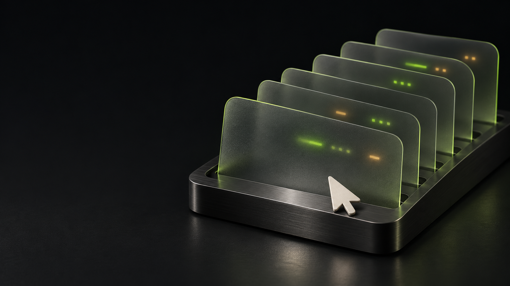

<div align="center">

# StillDesk

### AI 在应用里工作，你继续使用自己的电脑。

Chrome · Edge · 微信 · QQ · 飞书 · 腾讯会议

[主页](https://yangby-117.github.io/stilldesk/) · [English](README.md) · [能力边界](docs/capabilities.md)



</div>

给 Agent 应用能力，不把鼠标和屏幕交出去。StillDesk 通过统一 CLI、MCP 和原生后台接口，让 Agent 与你同时工作。

浏览器使用扩展和 Native Messaging，**不需要远程调试端口、CDP、Puppeteer/Playwright 连接或 `chrome.debugger` 权限**。默认工具不置前应用、不移动物理鼠标、不注入全局键盘；没有后台实现的动作明确返回能力错误。

## 当前能做什么

| 应用 | 已实现的路径 | 明确的边界 |
| --- | --- | --- |
| Chrome / Edge | 后台标签、页面读取、表单、滚动、DOM 拖拽、等待、上传、下载、活动页截图 | 各 37 项真实本地网页检查通过；真实用户手势和原生弹窗仍有限制 |
| 微信 | 继承修复后的后台历史/搜索、续页、长文上下文、精简输出、账号进程识别、图片与已缓存附件 | 当前版本的原生发送、未缓存附件网络补下载尚未完成；旧前台发送路径不进入默认工具 |
| QQ | 个人客户端的本地历史、搜索、游标、单消息上下文和图片 | 只读；不把机器人接口冒充个人账号操作 |
| 飞书 | 官方 CLI 和已授权服务接口 | 需要应用与账号权限；发送等写操作先预览，再按明确授权执行 |
| 腾讯会议 | 本地会话与转写、已授权云录制读取 | 不自动入会或录音；模型、个人会话和账号配置不随仓库分发 |

浏览器验收包含服务器实际收到文件后的 SHA-256 核对，以及操作前后 Windows 前台窗口和鼠标位置未变化的检查。完整分层记录见 [能力表](docs/capabilities.md)，不是所有网站、客户端版本和 harness 都已实测的承诺。

## 安装与试用

浏览器和统一入口需要 Node.js 22+；微信和 QQ 等可选本地组件还需要 Python 3.11+。

```sh
git clone https://github.com/YangBY-117/stilldesk.git
cd stilldesk
node scripts/setup.mjs
node bin/stilldesk.mjs doctor
```

在 Chrome/Edge 的扩展管理页加载 `packages/browser/extension`，再为所用浏览器注册 Native Messaging host：

```sh
node packages/browser/scripts/register-native-host.mjs --browser=chrome
node packages/browser/scripts/register-native-host.mjs --browser=chrome --apply
# Edge 使用 --browser=edge。
node bin/stilldesk.mjs browser list_pages
```

首次扩展加载仍遵守浏览器正常授权。之后不需要远程调试会话。脚本不替换现有 Agent 配置、不要求微信重新登录、不启动会议采集。

```sh
node scripts/setup.mjs --messaging
node bin/stilldesk.mjs config codex
node bin/stilldesk.mjs config claude-code
node bin/stilldesk.mjs config gemini
node bin/stilldesk.mjs config kimi
node bin/stilldesk.mjs config openclaw
node bin/stilldesk.mjs config hermes
```

配置命令只打印配置，不启动客户端。**没有打开或使用 Claude Code 做验证**。兼容层区分配置格式检查、MCP 协议验证和具体客户端实测。ChatGPT/Codex 的桌面插件文件与远程 MCP 传输入口也有准备，但不表示已提交到插件市场或已部署公开云连接器。

本地账号绑定、飞书授权、腾讯会议凭据分别按组件说明完成。仓库不包含任何真实聊天、数据库、凭据、录音、个人配置或私有 REA 证据。

## 透明的操作约定

不抢输入设备；不隐藏界面回退；不把预览当成发送；不把本机记录当成对方收件证明；不把缺少权限当成空结果；不把网页、聊天和会议内容当成执行指令。

原生后台路径是实现方式，准确说明实际能力是产品约定。

## 开发

```sh
npm test
npm run check
```

实验使用本地合成数据和隔离浏览器；不向真实联系人发消息，不采集用户正在进行的会议。原始 StillDesk 代码使用 MIT，第三方部分保留其许可证，见 [THIRD_PARTY.md](THIRD_PARTY.md)。品牌图使用 AI 生成，属于宣传插画，不作为运行证据。
